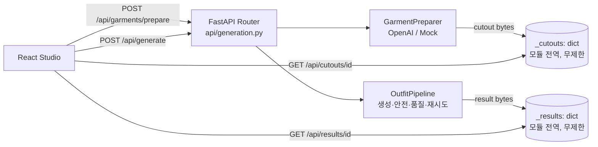
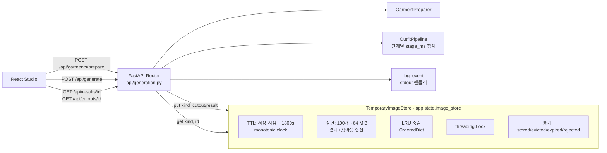

# 아키텍처 변경: 결과 이미지 저장 구조

## 1. 기존 구조 (커밋 `119bfff`)

- `backend/app/api/generation.py`에 모듈 전역 딕셔너리 `_results`, `_cutouts`가 있었습니다. 생성 결과와 의류 컷아웃의 `ImageAsset`(이미지 바이트 전체)을 여기에 넣고 **한 번도 삭제하지 않았습니다.**
- 만료 시간, 개수 상한, 바이트 상한이 없었습니다. 그래서 프로세스 메모리는 지금까지 처리한 요청 수에 비례해 계속 늘어납니다.
- 운영은 `deploy/try-on-me.service`에서 `--workers 1`, `MemoryHigh=300M`, `MemoryMax=384M`으로 실행합니다. 결과 1장이 약 2 MB, 컷아웃이 약 1.4 MB입니다. 따라서 수십~백여 건의 요청만으로 cgroup 한도에 닿을 수 있는 구조였습니다.
- 저장 상태를 관측할 방법도 없었습니다. 또 `try_on_me.observability` 로거에 출력 핸들러가 없어서, uvicorn으로 실행하면 `request_id` 단계 로그가 출력되지 않았습니다. Python 기본 핸들러가 WARNING 미만을 버리기 때문입니다.

## 2. 변경 후 구조

| 컴포넌트 | 역할 |
|---|---|
| `app/services/temporary_image_store.py` · `TemporaryImageStore` | 결과와 컷아웃을 하나의 바이트 예산 안에서 보관합니다. `put(kind, image)`는 만료 항목을 먼저 지우고, 그래도 상한을 넘으면 가장 오래 사용되지 않은 항목부터 축출한 뒤 저장합니다. 예산보다 큰 이미지 1장은 아무것도 지우지 않고 `ImageTooLargeToStoreError`로 거부합니다. `get(kind, id)`는 만료를 검사하고, 다른 종류(kind)의 ID로는 조회되지 않게 합니다. |
| `app/main.py` | 설정값으로 저장소를 만들어 `app.state.image_store`에 둡니다. 다른 Provider와 마찬가지로 앱 조립 시점에 주입하므로, 테스트에서는 시계와 상한을 바꾼 저장소로 교체할 수 있습니다. |
| `app/api/generation.py` | 전역 딕셔너리를 없애고 저장소를 사용합니다. 저장 불가 시 `507`을 반환합니다. 완료 로그에 단계별 시간, 출력 크기, 저장소 사용량, 축출·만료 수를 남깁니다. |
| `app/pipeline/outfit_pipeline.py` | 전처리·생성·안전·품질 단계 시간을 시도 횟수 전체에 걸쳐 합산해 `GenerationOutput.stage_ms`로 돌려줍니다. |
| `app/core/observability.py` | 로거에 stdout 핸들러를 붙여 INFO 이벤트가 실제로 출력되게 합니다. 로그 레벨이 꺼져 있으면 문자열을 만들기 전에 반환합니다. |
| `app/core/config.py` | `IMAGE_STORE_TTL_SECONDS`, `IMAGE_STORE_MAX_ITEMS`, `IMAGE_STORE_MAX_BYTES` 설정을 추가했습니다. |

## 3. API 호환성

| 항목 | 기존 | 변경 후 |
|---|---|---|
| `POST /api/generate` 응답 | `{status, result_url, retry_count}` | 동일 |
| `POST /api/garments/prepare` 응답 | `{..., cutout_url}` | 동일 |
| `GET /api/results/{id}` | 200 또는 404 | 동일. 만료·축출된 ID는 404 (`detail`: "Result not found or expired") |
| 저장 불가 | 없음 (무조건 저장) | `507 Insufficient Storage` + 한국어 `detail` |

프론트엔드(`generationApi.ts`)는 응답 직후 결과와 컷아웃 URL을 바로 가져옵니다. 그래서 TTL 30분 안에 조회가 끝나는 정상 흐름에서는 동작이 바뀌지 않습니다.

## 4. 설계 변경 이유 요약

- **무제한 보관이 문제의 원인이었습니다.** 메모리 누수(참조를 잃은 객체가 회수되지 않는 것)가 아닙니다. 객체는 모두 딕셔너리에서 정상적으로 참조되고 있었고, 지우는 정책이 없었을 뿐입니다. 그래서 GC나 메모리 프로파일러로 찾는 문제가 아니라, 보관 정책을 설계해야 하는 문제였습니다.
- 운영 조건이 단일 worker와 384 MiB 한도입니다. 보관 상한은 "프로세스 기본 메모리 + 요청 처리 중 일시 메모리 + 저장소"가 `MemoryHigh` 아래에 머물도록 정했습니다. 자세한 근거는 `technical-decisions.md`에 있습니다.
- 외부 저장소(Redis, S3)는 도입하지 않았습니다. 서비스에 계정도, 영구 보관 요구도 없기 때문입니다. 이 판단의 한계는 `technical-decisions.md`의 ADR-1에 적었습니다.
